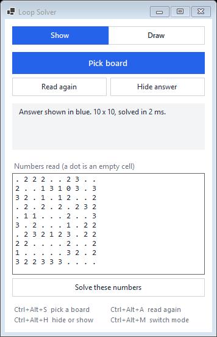

# Slitherlink Solver

Two tools that solve Slitherlink ("Loop the Loop") puzzles. Both can either **show** you the answer over the
board or **draw** it in for you, and you can switch between the two at any time. Neither uses AI: the solving is
plain logic.

| | Browser tool | Screen tool |
|---|---|---|
| Works on | puzzle-loop.com | Any website, app or picture showing a board with dots and numbers |
| Reads the puzzle | From the page's own data, so always exact | From the screen, by finding the dots and reading the numbers |
| You need | A bookmark (or the Tampermonkey extension) | Windows and the .NET 10 SDK |

## Get the code

```powershell
git clone https://github.com/limvleong04/PuzzleLoopSolver.git
cd PuzzleLoopSolver
```

The browser tool also needs [Node.js](https://nodejs.org) once, to build the bookmark. The screen tool needs the
[.NET 10 SDK](https://dotnet.microsoft.com/download).

## Browser tool (puzzle-loop.com)

### Set it up, without any extension

1. Build the bookmark once:

   ```powershell
   node browser/make-bookmarklet.js
   ```

2. Create a new bookmark in your browser and paste the whole of `browser/bookmarklet.txt` as its URL.
   Call it "Loop Solver".

Or, if you use **Tampermonkey**: create a new script, paste the whole of `browser/puzzle-loop-solver.user.js`,
and save. The panel then appears on every puzzle by itself.

### Use it

Open a puzzle and click the bookmark. A small **Loop Solver** panel appears in the bottom-right corner:

- **Show | Draw** chooses the mode. The choice is remembered.
- In **Show** mode, **Show answer** lays the loop over the board in blue. Your board isn't changed, so you can
  trace it yourself. Click again to hide it.
- In **Draw** mode, **Draw answer** fills the loop in. Wrong lines you drew yourself are removed, and undo still
  works.

The bookmark runs straight away in whichever mode is selected. Before showing or drawing anything, the answer is
checked against the solution check built into the page.

If the site's **auto-submit** setting is on, the site counts the puzzle as solved as soon as the last line is
drawn. Nothing is ever sent to the Hall of Fame; that stays a separate button.

## Screen tool (any website)

### Set it up

```powershell
cd desktop
dotnet run -c Release
```

Or build once with `dotnet build -c Release` and start `desktop\bin\Release\net10.0-windows\LoopSolver.exe`.
A small window appears in the bottom-right corner and stays on top:



### Use it

1. Choose **Show** or **Draw** at the top of the window (or press **Ctrl+Alt+M** to switch).
2. Press **Ctrl+Alt+S** (or **Pick board**). The screen freezes. Drag a box around the puzzle board. A rough box
   is fine; text and buttons around the board are ignored.
3. In **Show** mode, the loop appears in blue right over the board. Clicks go straight through it, so you can
   trace it on the page. **Ctrl+Alt+H** hides or shows it.
4. In **Draw** mode, the tool clicks the lines in for you with the mouse. Press **Esc**, or just move the mouse,
   to stop part-way.

When a new puzzle loads in the same place, press **Ctrl+Alt+A** (**Read again**) instead of picking the area again.

| Hotkey | What it does |
|---|---|
| **Ctrl+Alt+S** | Pick a board on screen, then show or draw the answer |
| **Ctrl+Alt+A** | Read the same area again |
| **Ctrl+Alt+H** | Hide or show the answer |
| **Ctrl+Alt+M** | Switch between Show and Draw |

### If a number is misread

The window lists the numbers it read, one row per board row, with a dot for an empty cell. If the numbers it read
don't give exactly one loop, it first tries the most doubtful ones as their next-best reading. If that still
fails, it tells you. Compare the list with the board, fix the wrong number, and click **Solve these numbers**.

### Tips

- Pick the board before drawing on it. It copes with lines and crosses already drawn, but a board that is
  completely drawn over hides the dots it needs.
- The answer is placed where the board was when it was read. If you scroll or zoom the page, press **Ctrl+Alt+A**.
- On very large boards, zoom the page in so each number is at least about 7 pixels tall.

### Settings

Stored in `%AppData%\LoopSolver\settings.json`. Close the tool before editing it.

| Setting | Default | Notes |
|---|---|---|
| `Mode` | `Show` | `Show` or `Draw`. The buttons change it too. |
| `DrawMethod` | `Click` | `Click` clicks the middle of each edge (puzzle-loop.com, Simon Tatham's Loopy). `Drag` drags from dot to dot, for sites where you draw by dragging, such as puzz.link. |
| `ClickDelayMs` | `30` | Pause between clicks in Draw mode. Raise it if a site misses clicks. |
| `LineColor` | `#1E90FF` | Colour of the answer in Show mode. |

## How the solver works

The board is a set of edges, each one "line", "no line" or "unknown". It repeats these rules until nothing
changes:

- **Numbers:** once a number has all its lines, its other edges are "no line". If it needs every remaining edge,
  they are all lines.
- **Dots:** every dot has either 0 or 2 lines.
- **One loop only:** a line may not close a loop unless that loop uses every line and meets every number.
- **Trial:** for each unknown edge, try "line" and "no line". If one leads to a contradiction, the other is right.
  If both lead to the same result somewhere else, that result is right.
- **Guess:** if the rules get stuck (rare), guess one edge and back out if it fails.

The screen tool also keeps looking after the first loop, to confirm it is the only one. A second loop means a
number was probably misread.

## Checks

```powershell
node test/run-tests.js
```

Solves the 15 real puzzles in `test/puzzles.json` (every size on puzzle-loop.com, up to the 40x50 Monthly) with the
browser tool's solver, and checks each answer against the site's own hash.

```powershell
desktop\bin\Release\net10.0-windows\LoopSolver.exe --selftest test\puzzles.json
desktop\bin\Release\net10.0-windows\LoopSolver.exe --check test\boards\boards.json
```

The first runs the same 15 puzzles through the screen tool's solver. The second reads the screenshots in
`test/boards` (puzzle-loop.com, Simon Tatham's Loopy and puzz.link, some with loose boxes and lines already
drawn) and compares every number with the right answer. `--read <picture> [x y width height]` reads any picture,
and `--snapshot <png> [picture x y width height]` saves a picture of the window (the one above was made this way).

## Files

| File | What's in it |
|---|---|
| `browser/puzzle-loop-solver.user.js` | Browser tool: solver and the Show/Draw panel. Also loads in Node for the tests. |
| `browser/make-bookmarklet.js` | Builds `browser/bookmarklet.txt` from the script. |
| `browser/cli.js` | Solve one puzzle-loop.com task from the command line and print the loop. |
| `desktop/ControlForm.cs` | Screen tool window, hotkeys and the Show/Draw actions |
| `desktop/BoardReader.cs`, `desktop/DigitClassifier.cs` | Finding the grid, reading the numbers and drawn lines |
| `desktop/Solver.cs`, `desktop/AnswerFinder.cs` | The solver, and retrying doubtful numbers |
| `desktop/AnswerOverlayForm.cs`, `desktop/MouseDriver.cs` | Show mode overlay and Draw mode clicking |
| `desktop/RegionPickerForm.cs`, `desktop/AppSettings.cs`, `desktop/NativeMethods.cs`, `desktop/ConsoleCommands.cs` | Box picker, settings, Windows calls, command-line checks |
| `test/` | Real puzzles with their answer hashes, and screenshots with the right numbers |
